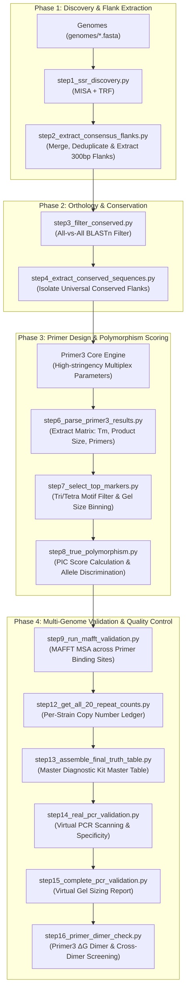

# Histoplasma capsulatum Universal STR Diagnostic Pipeline Plan
**Project**: Whole-Genome Multi-Locus STR Marker Discovery & Universal Multiplex PCR Diagnostic Kit Development  
**Target Organism**: *Histoplasma capsulatum* (NCBI Taxonomy ID: `5037`)  
**Methodological Reference**: *Turudić et al., 2024 (Dig-up Primers: A Pipeline for Identification of Polymorphic Microsatellites Loci within Assemblies of Related Species, IJMS 25(6):3169)*

---

## 1. Executive Summary & Diagnostic Concept

The goal of this project is to develop a **Universal Multi-Locus Variable-number tandem repeat Analysis (MLVA) Diagnostic Kit** for *Histoplasma capsulatum* using Whole Genome Sequencing (WGS) data.

### The "Oreo Cookie" Principle
For each candidate diagnostic marker:
1. **Flanking Regions (The Cookie)**: Must be **100% conserved** across all *Histoplasma* strains so that a single pair of universal primers achieves 100% amplification sensitivity without PCR dropouts or false negatives.
2. **Internal STR Core (The Cream Filling)**: Must be **hypervariable in repeat copy number** across strains/clades so that different isolates yield distinct amplicon sizes (length polymorphism) for high-resolution strain fingerprinting and outbreak tracking.

```
5' Flanking Region               Internal STR Repeat Core             3' Flanking Region
[ 100% CONSERVED ] -----------> [ (GAA)n HYPERVARIABLE ] -----------> [ 100% CONSERVED ]
   ▲                                                                      ▲
   │ Forward Primer Binds Here                                            │ Reverse Primer Binds Here
```

---

## 2. Genomic Dataset & WGS Catalog

* **Total Verified Runs**: 183 WGS datasets curated in `histoplasma_capsulatum_wgs_catalog.csv`.
* **Platform / Layout**: Illumina Paired-End ($100\%$ WGS, $100\%$ Genomic DNA).
* **Mean Sequencing Coverage**: $86.8\times$ (range $14.6\times - 340.3\times$, calibrated to $\sim 33\text{ Mb}$ genome).
* **Geographic Representation**: USA (110), South Africa (18), Brazil (13), Cameroon (4), Panama (2), French Guiana (2), Colombia (2), and other international isolates.

---

## 3. End-to-End Pipeline Architecture



---

## 4. Detailed Script Redesign & Implementation Map

### Phase 1: STR Discovery & Flank Extraction
* **`step1_ssr_discovery.py`**:
  * **Input**: `genomes/*.fasta`
  * **Tools**: MISA (`misa.pl`) and Tandem Repeats Finder (`trf`).
  * **Criteria**: Synchronized thresholds ($\text{Di}\ge 6, \text{Tri}\ge 5, \text{Tetra}\ge 5$; TRF $\text{MinScore}=24, \text{MaxPeriod}=4$).
* **`step2_extract_consensus_flanks.py`**:
  * **Function**: Removes redundancy by finding overlap ($\ge 15\text{ bp}$) between MISA and TRF.
  * **Extraction**: Extracts $300\text{ bp}$ upstream and $300\text{ bp}$ downstream flanks. Discards loci near contig boundaries lacking complete $300\text{ bp}$ flanks.
  * **Adaptation**: Fully dynamic $N$-sample scanning across all genomes.

### Phase 2: Cross-Genome Homology & Flank Conservation
* **`step3_filter_conserved.py`**:
  * **Function**: All-vs-all BLASTn search of extracted flanks against all other *Histoplasma* assemblies.
  * **Filter Stringency**: Percent identity $\ge 85\%$, Query coverage $\ge 80\%$, $E$-value $\le 10^{-10}$, single-copy orthology.
* **`step4_extract_conserved_sequences.py`**:
  * **Function**: Isolates verified universally conserved STR sequence blocks into FASTA for Primer3.

### Phase 3: Primer Design & Polymorphic Ranking
* **`step6_parse_primer3_results.py`**:
  * **Function**: Parses Primer3 output into a structured TSV matrix (Primers, $T_m \sim 59\text{–}61^\circ\text{C}$, GC content $40\text{–}60\%$, Product Size $150\text{–}450\text{ bp}$).
* **`step7_select_top_markers.py`**:
  * **Function**: Filters strictly for Tri- and Tetra-nucleotide motifs (prevents stutter bands associated with dinucleotides).
  * **Binning**: Bins markers into 3 non-overlapping size brackets ($150\text{–}230\text{ bp}$, $231\text{–}310\text{ bp}$, $311\text{–}450\text{ bp}$) for multiplex gel/capillary resolution.
* **`step8_true_polymorphism.py`** & **`step8_polymorphism_check.py`**:
  * **Function**: Calculates Polymorphism Information Content (PIC) across strains:
    $$\text{PIC} = 1 - \sum_{i=1}^{k} p_i^2 - \sum_{i=1}^{k-1} \sum_{j=i+1}^k 2 p_i^2 p_j^2$$
  * **Ranking**: Prioritizes markers with highest discriminatory power ($\text{PIC} > 0.5$).

### Phase 4: Multi-Genome Alignment, Kit Truth Table & Biophysical QC
* **`step9_run_mafft_validation.py`**:
  * **Function**: Runs MAFFT alignment across all primer binding sequences.
  * **Threshold**: Requires $100\%$ sequence conservation across primer annealing sites (0 SNPs).
* **`step12_get_all_20_repeat_counts.py`**:
  * **Function**: Builds multi-strain repeat copy number matrix ($n$) for top validated markers.
* **`step13_assemble_final_truth_table.py`**:
  * **Output**: `TRUE_final_diagnostic_kit.tsv` (The definitive laboratory diagnostic panel).
* **`step14_real_pcr_validation.py`** & **`step15_complete_pcr_validation.py`**:
  * **Function**: Executes virtual *in-silico* PCR against all whole genome assemblies. Confirms single-band amplification and band separation across clades.
* **`step16_primer_dimer_check.py`**:
  * **Function**: Screens all primers in the multiplex panel for self-dimers, hairpins, and cross-dimers using thermodynamic free energy ($\Delta G \ge -9.0\text{ kcal/mol}$).

---

## 5. Pipeline Execution Checklist

| Step | Script | Input | Key Output |
| :--- | :--- | :--- | :--- |
| **01** | `step1_ssr_discovery.py` | `genomes/*.fasta` | `misa/outputs/*.misa`, `trf/outputs/*.dat` |
| **02** | `step2_extract_consensus_flanks.py` | MISA & TRF outputs | `flanking_sequences/*_consensus_flanks.fasta` |
| **03** | `step3_filter_conserved.py` | `blast/outputs/*.tab` | `results/step2_conserved_loci/conserved_loci_metadata.txt` |
| **04** | `step4_extract_conserved_sequences.py` | Conserved metadata | `results/step3_conserved_sequences/conserved_flanks.fasta` |
| **05** | `primer3_core` execution | Primer3 config / input | `primer3/outputs/designed_primers.p3out` |
| **06** | `step6_parse_primer3_results.py` | Primer3 output | `results/final_primer_panel/universal_str_primers.tsv` |
| **07** | `step7_select_top_markers.py` | Universal primers | `results/final_primer_panel/top_universal_candidates.tsv` |
| **08** | `step8_true_polymorphism.py` | Primer matrix | `results/final_primer_panel/true_polymorphic_ranked_markers.tsv` |
| **09** | `step9_run_mafft_validation.py` | Ranked markers | `results/stage5_msa_validation/mafft_validated_diagnostic_panel.tsv` |
| **12** | `step12_get_all_20_repeat_counts.py` | Validated panel | `results/final_primer_panel/top_20_strain_repeat_matrix.tsv` |
| **13** | `step13_assemble_final_truth_table.py` | Repeat matrix + Primers | `results/final_primer_panel/TRUE_final_diagnostic_kit.tsv` |
| **14** | `step14_real_pcr_validation.py` | Final kit + Assemblies | Virtual PCR Amplicon Verification |
| **15** | `step15_complete_pcr_validation.py` | Final kit | `results/stage6_biophysical_validation/complete_insilico_pcr_report.txt` |
| **16** | `step16_primer_dimer_check.py` | Final kit | `results/stage6_biophysical_validation/primer_dimer_screening_report.tsv` |

